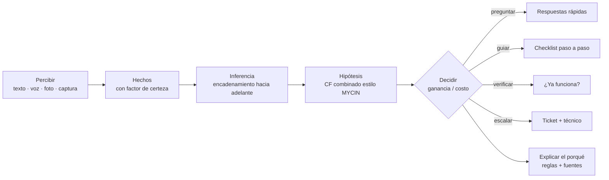
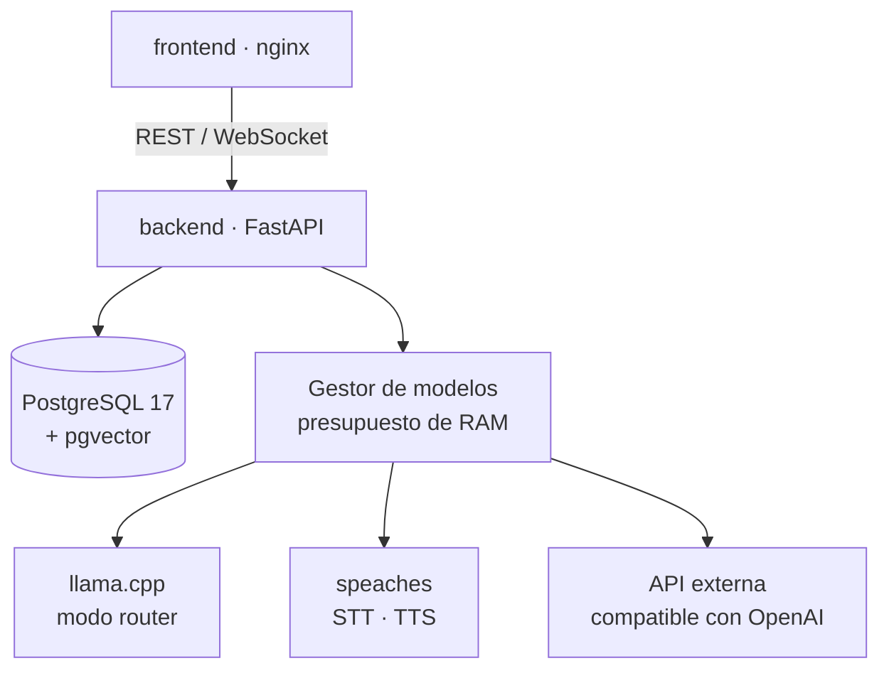

<div align="center">

# TRAMA · Backend

**El cerebro de un agente experto que diagnostica fallas de red del hogar: reglas, certeza, RAG y voz, todo local.**

FastAPI · PostgreSQL 17 + pgvector · llama.cpp · speaches (STT/TTS) · Docker

[Frontend](https://github.com/JhefersonCh/frontend-trama) · Taller *Sistemas Expertos* — UniPutumayo

</div>

---


## La idea en una frase

> **El código decide; el modelo de lenguaje interpreta y redacta.** Nada se afirma sin evidencia.

TRAMA es un **sistema experto clásico**, con hechos, reglas e inferencia, combinado con un LLM que entiende el lenguaje natural y explica con palabras sencillas. El diagnóstico no depende de lo que el modelo "crea": sale de reglas auditables y de factores de certeza.

## Cómo piensa el agente



| Pieza | Qué hace | Dónde |
|---|---|---|
| **Base de reglas** | 10 hipótesis (caída del proveedor, solo un dispositivo, DNS, Wi-Fi, IP duplicada…) y 21 reglas en YAML, versionadas en la base de datos | `rules/`, `app/agent/` |
| **Factores de certeza** | Cada hecho tiene su certeza; las reglas se combinan con el método de MYCIN | `app/agent/` |
| **Selector de acciones** | Elige la pregunta o el paso que más información aporta al menor costo, sin repetir lo ya hecho | `app/conversation/agent_policy.py` |
| **Ciclo de vida del caso** | nuevo → entendiendo → diagnosticando → intentando solución → verificando → resuelto o escalado → seguimiento → cerrado | `app/agent/lifecycle.py` |
| **Traza de decisiones** | Cada turno guarda qué percibió, qué reglas se cumplieron y por qué actuó así | tabla `decision_trace` |
| **RAG determinista** | Busca en el corpus en cada turno, solo con puntuación ≥ 0,7, y cita las fuentes `[1]` | `app/knowledge/` |
| **Interfaz generativa** | Responde con componentes validados (checklist, diagrama de red, flujo del diagnóstico…) | `app/ui/` |
| **Trabajo proactivo** | Seguimientos, vigilancia del SLA y temporizadores de pasos | `app/proactive/` |

## Funciones

- 🎙️ **Voz completa:** transcripción (faster-whisper) y síntesis (Kokoro o Piper) con speaches, mensaje por mensaje por WebSocket.
- 📷 **Visión:** lee las luces del módem en una foto y transcribe capturas de pantalla (`ipconfig`, `ping`).
- 🧰 **Herramientas configurables desde la interfaz:** `builtin`, `static_template`, `rag_search`, `sql_readonly` (rol de solo lectura), `http_request` (con protección SSRF) y `client_tool`.
- 🎫 **Tickets con asignación automática** de técnico por zona, especialidad y modalidad, con plazo (SLA) y línea de tiempo.
- 📄 **Informes del caso** en HTML y PDF (WeasyPrint).
- 🏷️ **Títulos de chat generados por el LLM** a partir del primer mensaje.
- 🧠 **Gestor de modelos con presupuesto de RAM:** carga y descarga modelos según la demanda. Pensado para un portátil sin GPU.

## Arquitectura



El código está organizado **por dominio**, con puertos y adaptadores donde hay infraestructura de por medio:

```
app/
├── agent/           Motor experto: reglas, certeza, ciclo de vida, traza
├── conversation/    Turnos por WebSocket, intenciones, política, prompts
├── knowledge/       Ingesta, fragmentación, embeddings y búsqueda
├── ui/              Constructores y validación de componentes generativos
├── tools/           Registro de herramientas y sus protecciones (SQL, SSRF)
├── media/           Visión (fotos y capturas) y audio
├── tickets/         Tickets, SLA y seguimiento
├── technicians/     Técnicos, zonas y asignación
├── proactive/       Trabajos programados y notificaciones
├── reports/         Informes del caso y diagrama de la red
├── insights/        Métricas y diagnóstico de casos
├── models_runtime/  Gestor de modelos y presupuesto de RAM
├── runtimes/        Adaptadores: llama.cpp, speaches, compatibles con OpenAI
└── config/          Proveedores, perfiles de modelo, ajustes y secretos
```

## Cómo ejecutarlo

```bash
docker compose --profile core up -d --build
```

| Servicio | Puerto | Notas |
|---|---|---|
| `backend` | 8000 | API en `/api`, salud en `/health`, documentación en `/docs` |
| `db` | 5433 | PostgreSQL 17 + pgvector |

El stack crea la red Docker **`trama-net`**, que usa el frontend para llegar a `backend:8000`.

### Perfiles

| Perfil | Servicios | Cuándo |
|---|---|---|
| `core` | `db`, `migrate` (una sola vez), `backend` | siempre |
| `llm` | `llm-llamacpp` (modo router), `llm-ollama` | modelos locales |
| `voice` | `voice` (speaches) | modo voz |

```bash
docker compose --profile core --profile llm --profile voice up -d
```

> Correr todo a la vez satura un portátil WSL2 de 12 GB. Los servicios de modelos arrancan **vacíos** y el gestor carga cada modelo solo cuando se necesita. El primer uso descarga los modelos a los volúmenes `models-gguf`, `models-voice` y `models-ollama`.

Endpoints verificados, latencias y consumo de RAM medidos: [`docs/runtime-endpoints.md`](docs/runtime-endpoints.md).

### Base de datos

- `migrate` aplica en orden `database/migrations/*.sql` y luego `database/seeds/*.sql`. Cada archivo corre en una transacción y queda registrado en `schema_migrations`.
- Los seeds nuevos deben ser idempotentes (`ON CONFLICT` / `UPDATE`).
- Para reiniciar la base: `docker compose --profile core down -v`.

### Desarrollo

```bash
uv sync
uv run pytest        # pruebas de endpoints con dobles en memoria, sin base de datos
uv run ruff check
```

### Corpus de conocimiento

`knowledge_base/` trae los documentos base (luces del módem, DHCP/APIPA, DNS, Wi-Fi, diagnóstico por capas) y casos de diagnóstico. El texto original de las fuentes externas no se versiona; se vuelve a descargar con `scripts/fetch_sources.py`.

## Reglas del proyecto

- 🔐 **Nada de credenciales en `.env`.** Los modelos y sus claves se configuran desde la interfaz y se guardan **cifrados con Fernet** en la base de datos. La llave maestra se genera en el primer arranque, en el volumen `trama-secrets`.
- 🙊 **Los datos de contacto nunca van a los logs** y se ocultan antes de llegar al modelo.
- 🧾 **Toda decisión queda trazada** y se puede explicar a la persona ("¿por qué cree eso?").
- ⚙️ **Todo es configurable desde la interfaz:** límites de tokens por tipo de turno, palabra de activación, umbral de RAG, autonomía del agente, zonas y herramientas.

---

<div align="center">
<sub>Proyecto académico · Taller de Sistemas Expertos · UniPutumayo</sub>
</div>
